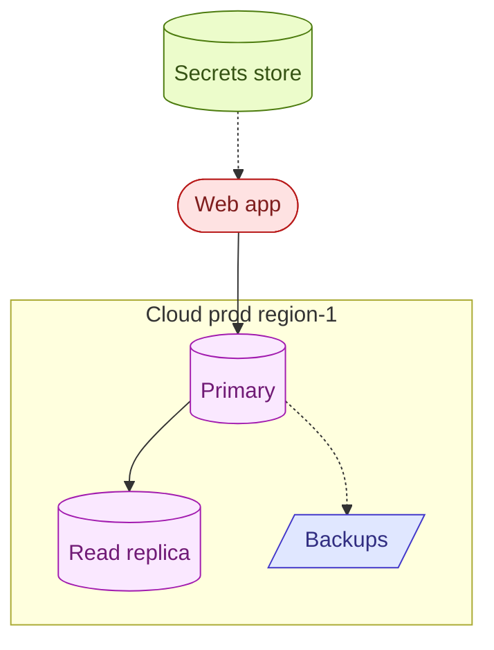

# Mermaid for Excalidraw

Write Mermaid that renders as a CLEAN architecture diagram. The output is `.mmd` code the user pastes into Excalidraw. Excalidraw's Mermaid import is strict and unforgiving: it does NOT render HTML, and it sizes boxes to the literal text. Cramped or tag-laden Mermaid that looks fine on mermaid.live comes out broken in Excalidraw.

## The non-negotiable rules

1. **No HTML tags, ever.** `<br>`, `<br/>`, `<b>`, `<i>`, `<sub>` render as LITERAL TEXT ("br" shows up in the box). One short line per node. If you need a second line, you almost certainly have too much text - cut it.
2. **Terse labels.** A node label is a NAME, not a spec sheet. `Primary` not `Primary app-db-prod 8 vCPU 32 GB v15.4 500 GB SSD 12k IOPS`. 1-3 words. The reader recognizes the box by its name; details live in a caption beside the diagram, never inside the box.
3. **No labels on arrows.** Excalidraw renders edge labels sitting ON the arrow line, overlapping the arrowhead and any box/subgraph border the arrow crosses. Default to NO edge label at all; let the shapes, colors, and layout carry the meaning. Only add one if it is truly essential, and then 1 word max.
4. **Few boxes.** A topology diagram is 4-7 nodes. If you have more, you are drawing the wrong altitude - group or drop detail.
5. **No sentences anywhere on the canvas.** Not in nodes, not on edges, not in subgraph titles. `Cloud prod region-1` is fine; `Cloud prod - region-1 - encrypted at rest` is a caption, not a title.

## What goes where

- **Inside boxes:** the component's short name only.
- **On edges:** the relationship in 1-2 words, or nothing.
- **Details (instance class, sizing, retention, region notes, encryption):** in prose UNDER the diagram, in the chat reply, or a separate legend. NEVER in the boxes.

## Shape vocabulary (use shape to convey type, not text)

- `([Name])` stadium - external actor / app
- `[(Name)]` cylinder - database / datastore
- `[Name]` rectangle - service / compute
- `[/Name/]` parallelogram - backups / artifacts / files
- `{Name}` diamond - decision (rare in architecture)
- dashed edge `-.->` for indirect / metadata / async; solid `-->` for primary data/control flow

## Color: classDef, applied sparingly

Group nodes by role and give each role one fill + matching stroke + readable text color. 4-5 classes max. Pastel fills with a darker stroke of the same hue read well on Excalidraw's white canvas.

```
classDef app fill:#fee2e2,stroke:#b91c1c,color:#7f1d1d;
classDef db fill:#fae8ff,stroke:#a21caf,color:#701a75;
classDef store fill:#ecfccb,stroke:#4d7c0f,color:#365314;
classDef misc fill:#e0e7ff,stroke:#4338ca,color:#312e81;
```

Assign with `class NODE1,NODE2 classname;` at the end of the file.

## Canonical example (a prod database topology)



Then put the spec in the reply, not the canvas: "Primary = db.r7g.2xlarge, PG 15.17, 500 GiB gp3; replica = db.r7g.large; backups 14-day retention."

## Workflow

1. Write the `.mmd` to a file so the user can copy it cleanly.
2. Match the requested altitude: the user asked for a *database* diagram, draw the DB topology - not the deploy/copy pipeline that happens to touch it.
3. Self-check before handing off, reject the draft if any of these are true:
   - any `<` character appears in a label
   - any arrow has a label (drop it unless truly essential)
   - any subgraph title is a sentence
   - more than ~7 nodes
4. Keep details OUT of the canvas; deliver them as prose alongside.
